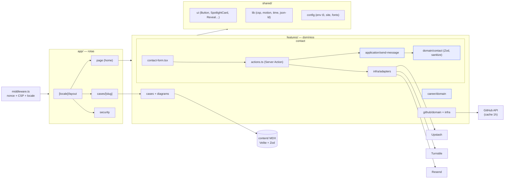

# Vander Reis — Portfólio

> Entrei na tecnologia em 2020 e, em menos de 3 anos de mercado, saí de estagiário para sênior.

Portfólio pessoal de **Vander Reis**, Desenvolvedor Back-end Sênior na Tech One. Construído como
um projeto de produção: arquitetura em camadas, TDD, CSP estrita com nonce, i18n e CI com
pipeline de segurança.

**Stack:** Next.js 15 (App Router, Server Components, Server Actions) · React 19 · TypeScript strict ·
Tailwind CSS v4 · Motion · Lenis · Velite (MDX + Zod) · next-intl · Resend · Upstash · Turnstile ·
Vitest · Playwright · Biome · Vercel.

## Rodando localmente

Requisitos: Node.js ≥ 20.18 e pnpm 10.

```bash
pnpm install
pnpm dev          # http://localhost:3000  (pt-BR)  ·  /en  (inglês)
```

Nenhuma variável de ambiente é obrigatória em desenvolvimento — sem chaves, o rate limit roda em
memória, o captcha é desativado e o envio de e-mail é simulado. Veja `.env.example`.

| Script            | O que faz                                        |
| ----------------- | ------------------------------------------------ |
| `pnpm dev`        | Compila o conteúdo (Velite) e sobe o Next (Turbopack) |
| `pnpm build`      | Build de produção                                |
| `pnpm test`       | Testes unitários (Vitest + Testing Library)      |
| `pnpm test:e2e`   | E2E + acessibilidade (Playwright + axe) no build de produção |
| `pnpm lint`       | Biome (lint + format)                            |
| `pnpm typecheck`  | `tsc --noEmit`                                   |

## Arquitetura



- `domain/` e `application/` são TypeScript puro, sem framework, cobertos por testes.
- Server Components por padrão; `'use client'` apenas onde há interação/animação.
- Decisões em [`docs/adr/`](docs/adr) · design system em [`docs/design-system.md`](docs/design-system.md).

## Segurança

CSP com nonce por requisição (`'strict-dynamic'`, sem `'unsafe-inline'` em scripts), HSTS preload,
COOP/CORP, `frame-ancestors 'none'`, formulário com Zod + Turnstile + rate limit + honeypot, e CI com
CodeQL, gitleaks, `pnpm audit`, SBOM e OWASP ZAP. Detalhes em [`SECURITY.md`](SECURITY.md) e na
página `/security` do site.

## Qualidade

- TDD: regras de negócio e testes antes da implementação.
- Lighthouse CI: Performance ≥ 95, Acessibilidade / Boas práticas / SEO = 100.
- Pipeline: lint → typecheck → testes → build → e2e/a11y → Lighthouse, e security em paralelo.
- Conventional Commits (commitlint) + Husky + lint-staged.

## Deploy (Vercel)

1. Importe o repositório na Vercel (framework: Next.js; o `packageManager` define o pnpm).
2. Configure as variáveis de `.env.example` (todas opcionais, mas em produção configure Resend,
   Turnstile e Upstash para o formulário funcionar).
3. Ative a proteção da branch `main` exigindo os checks de CI e revisão.
4. Depois do primeiro deploy, envie o domínio para <https://hstspreload.org>.
